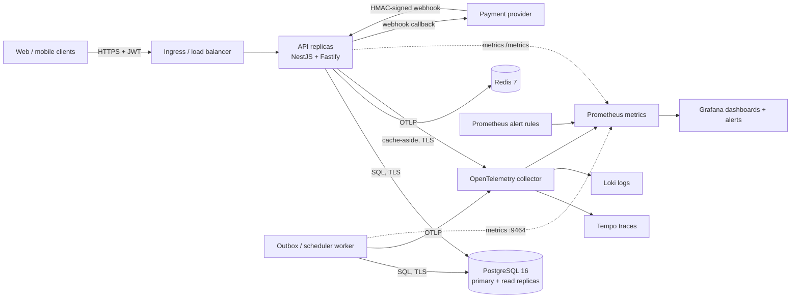
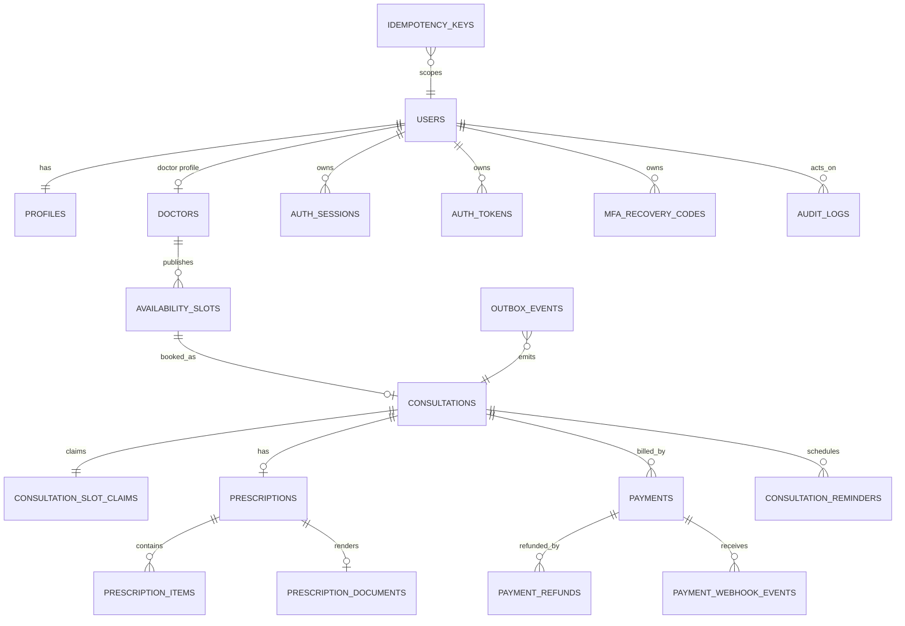
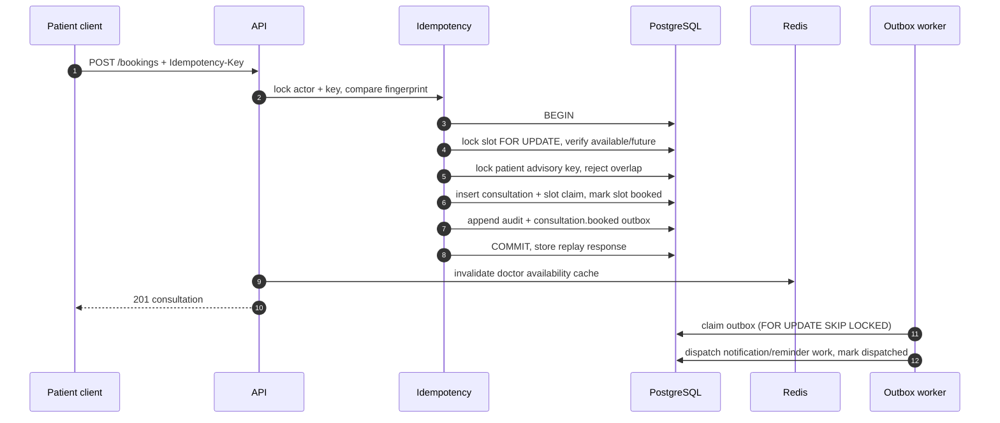

# Architecture

## 1. Context and goals

Amrutam is a telemedicine backend for patient identity, doctor discovery, slot booking, consultations, prescriptions, payments, audit, and admin analytics. The target is **100,000 consultations/day** (≈1.2 average, with 20–30× peak bursts) at **p95 reads <200 ms**, **p95 writes <500 ms**, and **99.95% monthly availability**.

The implementation is a **modular monolith** with a separately scalable outbox worker. Modules have explicit service boundaries and can be extracted later, but one deployable API keeps transactions, ownership checks, and clinical invariants simple. See [ADR 0001](decisions/0001-modular-monolith.md).

Production topology runs the API and worker as separate Kubernetes Deployments, at least three API replicas across zones, at least two worker replicas, a Multi-AZ RDS PostgreSQL instance with read replicas, and a Multi-AZ ElastiCache replication group. Local Compose provides the same process boundaries.

## 2. Request path

1. The Fastify adapter assigns/validates `X-Request-Id`, applies body limits, CORS, Helmet headers, compression, and the global rate limit.
2. The global JWT guard authenticates every route by default. `@Public()` is an explicit, reviewable exception list (health, registration, login, MFA challenge, password recovery, doctor discovery, payment webhooks, metrics).
3. The global roles guard enforces coarse roles. Services enforce resource ownership and state transitions in SQL transactions; they never trust a role from a path parameter.
4. Writes use a transactional **idempotency envelope**. A unique `(actor_id, idempotency_key)` row stores the request fingerprint and eventual response. A PostgreSQL advisory transaction lock serialises concurrent duplicates. Replays return the original status/body with `Idempotency-Replayed: true`; a different body with the same key returns `422 IDEMPOTENCY_KEY_REUSED`.
5. Every state change appends an audit record and, where asynchronous work is required, an outbox event in the **same transaction**. The response is not committed if audit or outbox insertion fails.
6. Pino emits structured JSON with redacted authorization headers, passwords, and tokens. Prometheus metrics observe route-template latency and status codes.

## 3. Data model and partitioning

- `consultations` is hash-partitioned into 16 partitions by `id`; lookups include the partition key and indexes support patient/doctor/status/time access paths.
- `audit_logs` is range-partitioned monthly. A scheduler pre-creates partitions.
- Doctors publish and remove their own one-off slots through authenticated endpoints; the GiST exclusion constraint rejects overlaps, and only `available` slots can be removed. `consultation_slot_claims` has a primary key on `slot_id`; the exclusion constraint is the final database-level defence against overlapping doctor bookings.
- Money is stored in integer minor units (`amount_cents`, INR), never floating point.
- UUIDv7 identifiers keep index locality while remaining globally unique.
- Prescription documents store immutable rendered bytes and a SHA-256 digest. Signing cannot be overwritten.

## 4. Booking and compensation flows

### 4.1 Booking

The database exclusion constraint plus the single transaction means two parallel requests for one slot cannot both succeed. Idempotent replay returns the winner's response rather than creating a second consultation.

### 4.2 Payment and cancellation saga

- The server derives the fee from the doctor/slot; clients cannot submit an amount.
- A partial unique index permits only one active payment per consultation.
- Provider webhooks are public capability routes verified against the **raw** request body with HMAC-SHA256 and a required secret. Events are deduplicated on `(provider, provider_event_id)`.
- Cancellation commits the clinical state change and a `payment.refund_requested` outbox event. The worker calls `refundForSystem`, which locks the payment, writes the append-only refund ledger, updates totals, appends audit, and emits `payment.refunded`. The handler is idempotent and retries with exponential backoff and jitter. A reconciliation job catches captured payments on cancelled consultations that were missed during a race.
- Payment capture after cancellation is rejected by the webhook state check.

This is a local saga: the clinical cancellation never waits for the payment provider, and money movement is eventually consistent with bounded retries and a dead-letter queue.

## 5. Async processing, retries, and scheduling

A PostgreSQL transactional outbox is used instead of a separate broker for the assignment size (see [ADR 0005](decisions/0005-postgres-outbox.md)). It preserves the transaction boundary without dual-write risk and scales horizontally with `FOR UPDATE SKIP LOCKED`.

- Workers claim bounded batches; stale processing locks are recovered.
- Failures are retried up to `OUTBOX_MAX_ATTEMPTS` with exponential backoff (base 1 s, cap 5 min, 50–100% jitter).
- Terminal failures land in `dead_letter`, are exposed as `amrutam_outbox_backlog{status="dead_letter"}`, and can be inspected/replayed with `npm run jobs:status` / `npm run jobs:replay`.
- Scheduled jobs (reminders, no-show detection, expired slot holds, payment reconciliation, audit partition maintenance, idempotency cleanup) run behind PostgreSQL advisory transaction locks, so replicas cannot double-run a job.
- Reminders are deduplicated by `(consultation_id, reminder_type)`. No-show detection locks candidate rows and writes audit/outbox in the same transaction.

If asynchronous volume grows beyond what PostgreSQL can cheaply serve, the same outbox rows can be relayed into Kafka/SQS without changing domain code. The dispatcher is an adapter boundary.

## 6. Caching and consistency

- Redis caches public doctor lists/details and availability for 30–120 s. Cache is **fail-open**: errors and outages fall back to PostgreSQL.
- Booking, cancellation, rescheduling, admin verification, and availability changes invalidate the affected doctor keys/prefixes.
- PHI, consultation content, prescriptions, payments, and audit data are never cached.
- Cache keys include every filter/sort/page input via a SHA-256 hash to prevent cross-filter contamination.
- Read replicas can serve doctor search and analytics in production; booking reads and every write use the primary to avoid stale-lock decisions.

## 7. Availability, failure modes, and scale

| Failure                | Behaviour                                                                                                    |
| ---------------------- | ------------------------------------------------------------------------------------------------------------ |
| Redis unavailable      | API continues; cache reads miss and writes are skipped; readiness stays green because cache is optional      |
| PostgreSQL unavailable | Readiness returns 503; in-flight transactions roll back; Kubernetes stops routing new traffic to the replica |
| Worker down            | Clinical writes still commit; outbox backlog and alerts grow; no double booking or lost audit                |
| Payment provider down  | Cancellation still commits; refund event retries with backoff and alerts after 10 failures                   |
| Webhook replay         | Provider event dedupe plus idempotent payment transitions                                                    |
| Migration failure      | Advisory-locked, transactional runner; deploy gate stops on a failed migration job                           |

Targets are protected by: multi-AZ data services, at least three API replicas with PodDisruptionBudgets, read replicas for read-heavy search/analytics, bounded connection pools (use PgBouncer in front of RDS at sustained scale), compression, body limits, statement timeouts, and HPA on CPU/memory plus outbox backlog.

## 8. Observability and operations

- **Traces:** optional OpenTelemetry SDK with auto-instrumentation for HTTP, PostgreSQL, Redis, and OTLP export to Tempo. The worker emits its own `outbox.process` span; producer-to-worker trace-context linking across the outbox boundary is a future enhancement.
- **Metrics:** Prometheus client exposes RED metrics plus outbox backlog/dead-letter and business-event counters. API scrape: `/metrics`; worker scrape: `:9464/metrics`.
- **Logs:** structured Pino JSON with request IDs, trace/span IDs when tracing is enabled, and redaction. Loki receives OTLP logs via the collector.
- **Dashboards/alerts:** `infra/observability/grafana/dashboards/amrutam-overview.json`, `infra/observability/prometheus/alerts.yml`.
- **Health:** `/health/live` is process liveness; `/health/ready` checks PostgreSQL with a 2 s timeout and returns 503 when a required dependency is unavailable.
- **Runbooks:** [runbooks.md](runbooks.md). Backup and recovery: [backup-dr.md](backup-dr.md).

## 9. Security and privacy boundaries

Deny-by-default JWT and role guards, Argon2id password hashing, rotating HMAC-hashed refresh tokens, TOTP MFA for privileged roles, encrypted TOTP secrets, recovery-code hashing, lockout, session revocation, parameterised SQL, strict input validation, idempotency, audit hash chaining, HMAC webhook verification, and short-lived HMAC capability URLs for prescription documents. PHI is kept out of cache and audit metadata; logs redact secrets. Full threat model, data classification, key rotation, and residual risks are in [security.md](security.md).

## 10. Deliberate trade-offs

- **Modular monolith** over microservices: fewer distributed transactions and a single authorization boundary at this team size; module boundaries and outbox keep extraction possible.
- **SQL-first** over an ORM: explicit locking, partition-aware queries, and auditable invariants matter more than boilerplate reduction.
- **Postgres outbox** over BullMQ/Kafka: one transaction boundary and no Redis durability dependency for money movement; a broker can be added as a relay later.
- **Direct indexed analytics** over materialised views: 366-day capped ranges on indexed tables meet the current target; rollups can be introduced when data volume warrants it.
- **Capability URLs** for prescriptions instead of public object URLs: short TTL, HMAC-signed, no PHI in the URL.
